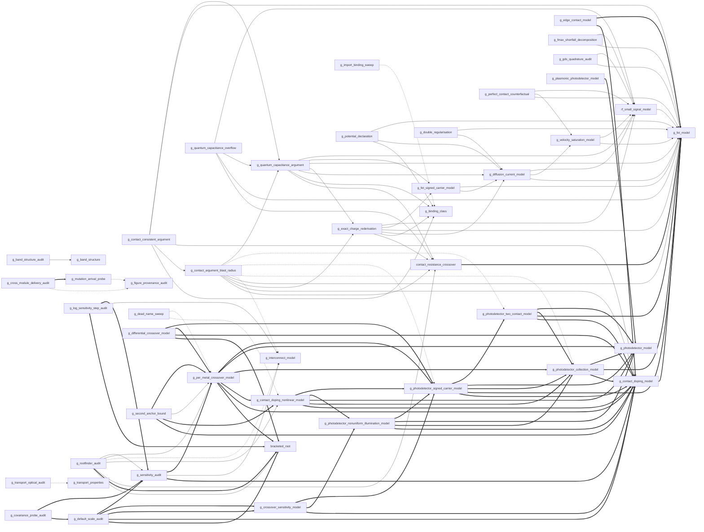

# Repository inventory (Phase 0)

Generated 2026-10-16 from `main` @ `2a72139`, read-only. Every number in this file was measured, not copied from the log. Section numbers refer to `thesis_draft/` as it stood at that commit (renamed `thesis/` in Phase 1).

## 0. Re-verified state

* 56 `.py`, 49 `.png`, 34 `*_output.txt` at the root; 43 notes; 7 chapters, 75 211 words (Ch 4 25 996, Ch 6 16 643, Ch 7 16 715); 231 commits. All as stated in the brief.
* **`requirements.txt` correction.** The file pins `sympy==1.12` (a real release, with no trailing newline), not `1.1243`. A clean install still fails or produces a broken environment, for a different reason: the other three pins (`numpy==1.24.3`, `scipy==1.10.1`, `matplotlib==3.7.1`) are incompatible with the code. `numpy==1.24.3` has no wheel for Python ≥ 3.12, which the code needs (PEP 701 f-strings, AUTOMATION_LOG 2026-10-07); on Python 3.11, where the pins do install, 19 of 54 scripts fail with `AttributeError: module 'numpy' has no attribute 'trapezoid'` (numpy ≥ 2.0 API). `mpmath` is imported directly (`graphene_quantum_capacitance_overflow.py`) but not listed.
* **Reference environment.** The log records the cloud container the committed transcripts were made in (AUTOMATION_LOG 2026-10-06/07: Python 3.13.16, numpy 2.5.3, scipy 1.18.1); committed PNGs carry `Software: Matplotlib version3.10.9`. The baseline below uses exactly that, in a clean venv.

## 1. Scripts

Class: **model** = computes a physical quantity a chapter reports; **audit** = verification of a model, a transcript or the audit layer itself; **infra** = shared helper; **legacy** = superseded demo.

| script | class | feeds | purpose | outputs written | imports from repo modules |
|---|---|---|---|---|---|
| `bracketed_root.py` | infra | — | Guarded bisection that raises on an unbracketed interval (§7.5.3 class iii fix) | — | — |
| `contact_resistance_crossover.py` | model | §1.3, §4.3, §4.4, §4.6.8 | Channel length at which R_c dominates total GFET resistance (§4.4) | `contact_resistance_crossover.png` | graphene_fet_model* |
| `generate_plots.py` | legacy | — | Early fundamentals plots; overwrites band_structure.png etc. from an older formula | `band_structure.png`, `density_of_states.png`, `honeycomb_lattice.png`, `optical_absorption.png`, `quantum_hall_effect.png` | — |
| `graphene_band_structure.py` | model | §1.1, §1.3, §2, §2.3 | Nearest-neighbour TB band structure, DOS, honeycomb lattice (Ch 2) | `band_structure.png`, `density_of_states.png`, `fermi_surface.png`, `honeycomb_lattice.png` | — |
| `graphene_band_structure_audit.py` | audit | §2, §2.3, §2.6 | Dirac-point / exact-value audit of the shipped band structure (§2.10) | `band_structure_audit_output.txt (stdout)` | graphene_band_structure |
| `graphene_binding_class.py` | infra | §4.6.13, §4.6.14, §7.9 | Context manager rebinding a name's whole import identity class (§4.6.13) | — | — |
| `graphene_contact_argument_blast_radius.py` | audit | §4.6.12, §4.6.14 | Measures how far the C_q-argument fix (item 16) reaches into the contact model (§4.6.12) | `contact_argument_blast_radius.png`, `contact_argument_blast_radius_output.txt` | contact_resistance_crossover, graphene_contact_doping_model, graphene_exact_charge_rederivation, graphene_fet_model, graphene_interconnect_model, graphene_photodetector_collection_model, graphene_photodetector_signed_carrier_model, graphene_photodetector_two_contact_model, graphene_quantum_capacitance_argument |
| `graphene_contact_consistent_argument.py` | model | §4.6.14 | Contact model with a self-consistent C_q argument; item 16 precondition (§4.6.14) | `contact_consistent_argument.png`, `contact_consistent_argument_output.txt (stdout)` | graphene_binding_class, graphene_contact_argument_blast_radius, graphene_contact_doping_model, graphene_fet_model, graphene_quantum_capacitance_argument |
| `graphene_contact_doping_model.py` | model | §1.3, §4.5, §4.6.12, §4.6.13 | Work-function doping profile near a contact, R_extra, per-metal R_c recalibration (§4.5, §4.7) | `contact_doping_profile.png`, `rc_recalibration.png` | graphene_fet_model* |
| `graphene_contact_doping_nonlinear_model.py` | model | §1.3, §6.11 | Square-root (Khomyakov) work-function→doping relation (§6.11) | `contact_doping_nonlinear_relation.png` | graphene_contact_doping_model*, graphene_photodetector_collection_model*, graphene_photodetector_model*, graphene_photodetector_nonuniform_illumination_model*, graphene_photodetector_signed_carrier_model* |
| `graphene_covariance_probe_audit.py` | audit | — | Audits the default-scale auditor's own components (note 2026-09-28) | — | graphene_default_scale_audit*, graphene_sensitivity_audit* |
| `graphene_cross_module_delivery_audit.py` | audit | §4.6 | Checks that cross-module rebinding actually reaches the consumer (note 2026-10-03) | `cross_module_delivery_audit.png` | graphene_figure_provenance_audit, graphene_mutation_arrival_probe* |
| `graphene_crossover_sensitivity_model.py` | model | §1.3 | Sensitivity band of the p/n crossover; scalar-offset sign invariance (§6.13) | `crossover_sensitivity.png` | graphene_contact_doping_model*, graphene_photodetector_nonuniform_illumination_model*, graphene_photodetector_signed_carrier_model* |
| `graphene_dead_name_sweep.py` | audit | §4.8.2 | Finds module-level constants nothing reads (note 2026-10-01) | — | graphene_contact_doping_nonlinear_model, graphene_per_metal_crossover_model |
| `graphene_default_scale_audit.py` | audit | — | Audits numeric defaults (tolerances/steps) against caller variable scale (note 2026-09-25) | `default_scale_audit.png`, `default_scale_audit_output.txt (stdout)` | bracketed_root*, graphene_contact_doping_model*, graphene_crossover_sensitivity_model*, graphene_sensitivity_audit* |
| `graphene_differential_crossover_model.py` | model | §1.3 | Differential crossover offset and closed-form sign-flip threshold (§6.14) | `differential_crossover.png`, `differential_crossover_output.txt (stdout)` | bracketed_root*, graphene_contact_doping_model*, graphene_per_metal_crossover_model*, graphene_photodetector_signed_carrier_model* |
| `graphene_diffusion_current_model.py` | model | §4.6.5, §4.6.6, §4.6.11, §7.8.1d | Diffusion term added to the GFET current (§4.6.5) | `diffusion_current_model.png`, `diffusion_current_output.txt` | graphene_fet_model, graphene_velocity_saturation_model, rf_small_signal_model |
| `graphene_diffusion_mutation.py` | audit | §4.6.5 | Mutation harness for the diffusion model | `diffusion_mutation_output.txt` | — |
| `graphene_double_regularisation.py` | model | §4.6.11 | Costs thermal + puddle double regularisation of C_q (§4.6.11) | `double_regularisation.png`, `double_regularisation_output.txt (stdout)` | graphene_diffusion_current_model, graphene_fet_model |
| `graphene_edge_contact_model.py` | model | §1.3, §4.8, §4.8.2, §4.9 | Edge vs top vs hole-array contact geometry (§4.8) | `edge_vs_top_contact.png` | graphene_contact_doping_model*, graphene_fet_model* |
| `graphene_exact_charge_rederivation.py` | model | §4.6.8, §7.9 | Chapter 4 re-derived on the exact charge relation (4.28) (§4.6.8) | `exact_charge_rederivation.png`, `exact_charge_rederivation_output.txt (stdout)` | contact_resistance_crossover, graphene_binding_class, graphene_diffusion_current_model, graphene_fet_model, graphene_fet_signed_carrier_model, rf_small_signal_model |
| `graphene_fet_model.py` | model | §1.1, §1.2, §1.3, §3.3 | Core GFET: C_q, self-consistent n, transfer characteristic, lumped R_c (§4.2–4.3) | `gfet_transfer_characteristics.png`, `quantum_capacitance.png` | — |
| `graphene_fet_signed_carrier_model.py` | model | §3.3.1, §4.6.7, §7.9 | Signed-carrier FET model; disorder floor (§4.6.7) | `fet_signed_carrier_model.png` | graphene_diffusion_current_model, graphene_fet_model |
| `graphene_figure_provenance_audit.py` | audit | — | Is each device figure computed from its model or drawn from a known answer? | `figure_provenance_audit.png` | — |
| `graphene_fmax_shortfall_decomposition.py` | model | §4.6.2 | Decomposes the f_max denominator; f_max is a resistance ratio (§4.6.2) | `fmax_shortfall_decomposition.png`, `fmax_shortfall_decomposition_output.txt (stdout)` | graphene_fet_model, rf_small_signal_model |
| `graphene_gds_quadrature_audit.py` | audit | §4.6.1 | Step/quadrature audit of g_ds finite difference (§4.6.1) | `gds_quadrature_audit.png`, `gds_quadrature_audit_output.txt (stdout)` | graphene_fet_model, rf_small_signal_model |
| `graphene_import_binding_sweep.py` | audit | — | Enumerates every import-time binding of every patched name (§4.6.13) | `import_binding_sweep.png`, `import_binding_sweep_output.txt` | graphene_binding_class |
| `graphene_interconnect_model.py` | model | §1.3, §4.6.12, §5, §5.2 | GNR vs Cu (with liners) resistivity vs linewidth (Ch 5) | `interconnect_resistivity_vs_linewidth.png` | — |
| `graphene_log_sensitivity_step_audit.py` | audit | — | Anchored audit of log_sensitivity's step and convergence estimate (§7.5.5) | `log_sensitivity_step_audit.png` | bracketed_root*, graphene_interconnect_model, graphene_sensitivity_audit* |
| `graphene_mutation_arrival_probe.py` | audit | — | Does an injected mutation arrive at the code it targets? (note 2026-09-30) | — | graphene_figure_provenance_audit |
| `graphene_per_metal_crossover_model.py` | model | §1.3 | Per-metal p/n crossover from the chemical interface term (§6.12) | `per_metal_crossover.png` | bracketed_root*, graphene_contact_doping_model*, graphene_contact_doping_nonlinear_model*, graphene_photodetector_collection_model*, graphene_photodetector_model*, graphene_photodetector_signed_carrier_model* |
| `graphene_perfect_contact_counterfactual.py` | model | §4.6.4, §7.8.1c | f_max/f_T at R_c = 0 exactly in the saturated model (§4.6.4) | `perfect_contact_counterfactual.png`, `perfect_contact_counterfactual_output.txt` | graphene_fet_model, graphene_velocity_saturation_model, rf_small_signal_model |
| `graphene_perfect_contact_mutation.py` | audit | — | Mutation harness for the perfect-contact counterfactual | `perfect_contact_mutation_output.txt` | — |
| `graphene_photodetector_collection_model.py` | model | §1.3, §6.6 | Single-contact spatial, metal-dependent collection efficiency (§6.6) | `photodetector_collection_efficiency_by_metal.png` | graphene_contact_doping_model*, graphene_fet_model*, graphene_photodetector_model* |
| `graphene_photodetector_model.py` | model | §1.3, §3.9, §6.4 | Responsivity / gain / bandwidth tradeoff (§6.4) | `photodetector_responsivity_gain_tradeoff.png` | — |
| `graphene_photodetector_nonuniform_illumination_model.py` | model | §6.9.2 | Collection kernel, shadow masks, illumination ceiling (§6.9) | `photodetector_nonuniform_illumination.png` | graphene_contact_doping_model*, graphene_photodetector_collection_model*, graphene_photodetector_model*, graphene_photodetector_signed_carrier_model* |
| `graphene_photodetector_signed_carrier_model.py` | model | §1.3 | Signed, carrier-resolved two-contact photocarrier model (§6.8) | `photodetector_signed_carrier_response.png` | graphene_contact_doping_model*, graphene_fet_model*, graphene_photodetector_collection_model*, graphene_photodetector_model*, graphene_photodetector_two_contact_model* |
| `graphene_photodetector_two_contact_model.py` | model | §1.3, §6.7 | Self-consistent two-contact collection (magnitude) (§6.7) | `photodetector_two_contact_net_response.png` | graphene_contact_doping_model*, graphene_fet_model*, graphene_photodetector_collection_model*, graphene_photodetector_model* |
| `graphene_plasmonic_photodetector_model.py` | model | §1.3, §6.5 | Plasmonic near-field absorption enhancement (§6.5) | `plasmonic_photodetector_enhancement.png` | graphene_photodetector_model* |
| `graphene_potential_census_audit.py` | audit | §4.6.6, §7.9 | Census of potential-like variables and which potential each is (§4.6.6) | — | — |
| `graphene_potential_declaration.py` | model | §4.6.6, §4.6.13, §7.9 | Declares which potential V_ch is and re-derives (§4.6.6) | — | graphene_binding_class, graphene_diffusion_current_model, graphene_fet_model |
| `graphene_pristine_transcript_audit.py` | audit | — | Re-runs registered suites in a pristine git clone and diffs committed transcripts | — | — |
| `graphene_quantum_capacitance_argument.py` | model | §4.6.9, §4.6.12 | Costs fixing C_q's argument (item 16) (§4.6.9) | `quantum_capacitance_argument.png` | contact_resistance_crossover, graphene_binding_class, graphene_diffusion_current_model, graphene_exact_charge_rederivation, graphene_fet_model, graphene_fet_signed_carrier_model, rf_small_signal_model |
| `graphene_quantum_capacitance_overflow.py` | audit | §4.6.10, §7.9 | Output-neutrality pass for the cosh overflow fix in C_q (§4.6.10) | — | contact_resistance_crossover, graphene_fet_model, graphene_quantum_capacitance_argument, rf_small_signal_model |
| `graphene_rootfinder_audit.py` | audit | §6.12.3 | Audits remaining analysis code for the unbracketed-root bug class | — | bracketed_root, bracketed_root*, contact_resistance_crossover, graphene_contact_doping_nonlinear_model, graphene_interconnect_model, graphene_per_metal_crossover_model, graphene_sensitivity_audit |
| `graphene_second_anchor_bound.py` | model | §7.9 | Second anchor for Δ_c is an inequality, not a number (note 2026-10-15) | `second_anchor_bound.png`, `second_anchor_bound_output.txt (stdout)` | graphene_contact_doping_model*, graphene_contact_doping_nonlinear_model*, graphene_per_metal_crossover_model, graphene_per_metal_crossover_model* |
| `graphene_sensitivity_audit.py` | audit | §4.7 | Condition-number audit of Ch 4/5 headline quantities (§4.10, §5.5) | `sensitivity_audit.png` | graphene_contact_doping_model*, graphene_interconnect_model, graphene_per_metal_crossover_model* |
| `graphene_transport_optical_audit.py` | audit | §1.3, §3, §3.9 | Audit of Chapter 3's computed results (§3.9) | `transport_optical_audit_output.txt (stdout)` | graphene_transport_properties |
| `graphene_transport_properties.py` | model | §1.1, §1.3, §3, §3.9 | Mobility, QHE, conductance map, Klein tunnelling, optics (Ch 3) | `conductance_map.png`, `klein_tunneling.png`, `linear_dispersion.png`, `mobility_vs_temperature.png`, `optical_properties.png`, `quantum_hall_effect.png` | — |
| `graphene_velocity_saturation_model.py` | model | §4.6.3, §4.6.13, §7.9 | Velocity-saturation term in the transfer characteristic (§4.6.3) | `velocity_saturation_model.png`, `velocity_saturation_output.txt` | graphene_fet_model, rf_small_signal_model |
| `graphene_velocity_saturation_mutation.py` | audit | — | Mutation harness for the velocity-saturation model | `velocity_saturation_mutation_output.txt` | — |
| `initialize_repo.py` | legacy | — | One-off git-init helper with a hardcoded Windows path; not run | — | — |
| `main.py` | legacy | §1.3, §2, §2.9, §4.5 | pip-installs and runs two Ch 2–3 scripts; superseded by scripts/reproduce_all.py; not run | — | — |
| `rf_small_signal_model.py` | model | §1.1, §1.2, §1.3, §4.6 | Small-signal f_T, f_max (§4.6) | `rf_figures_of_merit.png`, `rf_small_signal_output.txt (stdout)` | graphene_fet_model |
| `simple_graphene_plots.py` | legacy | — | Duplicate *_simple.png fundamentals plots | `band_structure_simple.png`, `density_of_states_simple.png`, `honeycomb_lattice_simple.png`, `optical_absorption_simple.png`, `quantum_hall_simple.png` | — |
| `summary.py` | legacy | §4.6.10, §4.6.12, §4.8.2, §6.5 | Prints a static text summary of textbook graphene facts | — | — |

`*` after an import = `from X import name` — a value bound at import time (the stale-binding class of §4.6.12–4.6.13). Plain names are `import X` (attribute lookup at call time).

## 2. Outputs → producer → citing sections

| output | producer | cited in | status |
|---|---|---|---|
| `audit_output.txt` | `graphene_sensitivity_audit.py` | §1.3, §2, §3, §3.9, §4.10.5 | SUPERSEDED: 2026-09-22 condition-number audit output; the module's current stdout is a different, longer report |
| `band_structure.png` | `graphene_band_structure.py` | §1.3, §2.10 | **two writers** (generate_plots.py, graphene_band_structure.py); last one wins |
| `band_structure_audit.png` | (earlier graphene_band_structure_audit.py) | — | **fossil**: no script at HEAD writes it; **orphan** (no chapter cites it) |
| `band_structure_audit_output.txt` | `graphene_band_structure_audit.py` | §2 | reproduces byte-for-byte at HEAD |
| `band_structure_simple.png` | `simple_graphene_plots.py` | §1.3, §2.10 | ok |
| `contact_argument_blast_radius.png` | `graphene_contact_argument_blast_radius.py` | §4.6.12 | ok |
| `contact_argument_blast_radius_output.txt` | `graphene_contact_argument_blast_radius.py` | §4.6.12 | reproduces byte-for-byte at HEAD |
| `contact_consistent_argument.png` | `graphene_contact_consistent_argument.py` | §4.6.14 | ok |
| `contact_consistent_argument_output.txt` | `graphene_contact_consistent_argument.py` | §4.6.14 | reproduces byte-for-byte at HEAD |
| `contact_doping_nonlinear_relation.png` | `graphene_contact_doping_nonlinear_model.py` | §1.3, §6.11.3 | ok |
| `contact_doping_profile.png` | `graphene_contact_doping_model.py` | §4.5 | ok |
| `contact_resistance_crossover.png` | `contact_resistance_crossover.py` | §4.4 | ok |
| `cross_module_delivery_audit.png` | `graphene_cross_module_delivery_audit.py` | — | **orphan** (no chapter cites it) |
| `cross_module_delivery_audit_output.txt` | `graphene_cross_module_delivery_audit.py` | — | STALE: captured defaults 8 → 16 at HEAD; **orphan** (no chapter cites it) |
| `crossover_sensitivity.png` | `graphene_crossover_sensitivity_model.py` | §1.3, §6.13.10 | ok |
| `dead_name_sweep_output.txt` | `graphene_dead_name_sweep.py` | §4.8.2 | STALE and now FAILING at HEAD: 1 DEAD constant, 12 unsupported CROSS_MODULE resolutions |
| `default_scale_audit.png` | `graphene_default_scale_audit.py` | §6.13.11 | ok |
| `default_scale_audit_output.txt` | `graphene_default_scale_audit.py` | §6.13.11 | reproduces byte-for-byte at HEAD |
| `default_scale_probe_audit.png` | (earlier graphene_covariance_probe_audit.py) | — | **fossil**: no script at HEAD writes it; **orphan** (no chapter cites it) |
| `default_scale_probe_audit_output.txt` | `graphene_covariance_probe_audit.py` | — | DRIFT: same line count, 14 changed numeric lines (worst ratio 0.383 → 0.072); **orphan** (no chapter cites it) |
| `density_of_states.png` | `graphene_band_structure.py` | §2.10 | **two writers** (generate_plots.py, graphene_band_structure.py); last one wins |
| `density_of_states_simple.png` | `simple_graphene_plots.py` | — | **orphan** (no chapter cites it) |
| `differential_crossover.png` | `graphene_differential_crossover_model.py` | §1.3, §6.14.8 | ok |
| `differential_crossover_output.txt` | `graphene_differential_crossover_model.py` | §6.14.5 | reproduces byte-for-byte at HEAD |
| `diffusion_current_model.png` | `graphene_diffusion_current_model.py` | §4.6.5 | ok |
| `diffusion_current_output.txt` | `graphene_diffusion_current_model.py` | §4.6.5 | reproduces byte-for-byte at HEAD |
| `diffusion_mutation_output.txt` | `graphene_diffusion_mutation.py` | §4.6.5 | reproduces byte-for-byte at HEAD |
| `double_regularisation.png` | `graphene_double_regularisation.py` | §4.6.11 | ok |
| `double_regularisation_output.txt` | `graphene_double_regularisation.py` | §4.6.11 | reproduces byte-for-byte at HEAD |
| `edge_vs_top_contact.png` | `graphene_edge_contact_model.py` | §4.8.1 | ok |
| `exact_charge_rederivation.png` | `graphene_exact_charge_rederivation.py` | §4.6.8 | ok |
| `exact_charge_rederivation_output.txt` | `graphene_exact_charge_rederivation.py` | §4.6.8 | reproduces byte-for-byte at HEAD |
| `fet_signed_carrier_model.png` | `graphene_fet_signed_carrier_model.py` | §4.6.7 | ok |
| `fet_signed_carrier_output.txt` | `graphene_fet_signed_carrier_model.py` | §3.3.1, §4.6.7 | DRIFT: one line, 1.772e-14 → 1.773e-14 (factor 119 → 120) |
| `figure_provenance_audit.png` | `graphene_figure_provenance_audit.py` | — | **orphan** (no chapter cites it) |
| `figure_provenance_audit_output.txt` | `graphene_figure_provenance_audit.py` | — | STALE: census line now '21 occurrences across 5 of 56 files' (was 0 of 38); **orphan** (no chapter cites it) |
| `fmax_shortfall_decomposition.png` | `graphene_fmax_shortfall_decomposition.py` | §4.6.2 | ok |
| `fmax_shortfall_decomposition_output.txt` | `graphene_fmax_shortfall_decomposition.py` | — | reproduces byte-for-byte at HEAD; **orphan** (no chapter cites it) |
| `gds_quadrature_audit.png` | `graphene_gds_quadrature_audit.py` | — | **orphan** (no chapter cites it) |
| `gds_quadrature_audit_output.txt` | `graphene_gds_quadrature_audit.py` | — | reproduces byte-for-byte at HEAD; **orphan** (no chapter cites it) |
| `gfet_transfer_characteristics.png` | `graphene_fet_model.py` | §1.2, §4.3 | ok |
| `honeycomb_lattice.png` | `graphene_band_structure.py` | — | **two writers** (generate_plots.py, graphene_band_structure.py); last one wins; **orphan** (no chapter cites it) |
| `honeycomb_lattice_simple.png` | `simple_graphene_plots.py` | — | **orphan** (no chapter cites it) |
| `import_binding_sweep.png` | `graphene_import_binding_sweep.py` | — | **orphan** (no chapter cites it) |
| `import_binding_sweep_output.txt` | `graphene_import_binding_sweep.py` | — | reproduces byte-for-byte at HEAD; **orphan** (no chapter cites it) |
| `interconnect_resistivity_vs_linewidth.png` | `graphene_interconnect_model.py` | — | **orphan** (no chapter cites it) |
| `log_sensitivity_step_audit.png` | `graphene_log_sensitivity_step_audit.py` | — | **orphan** (no chapter cites it) |
| `log_sensitivity_step_audit_output.txt` | `graphene_log_sensitivity_step_audit.py` | — | STALE: 84 changed lines; numbers beyond rtol 1e-9 (pristine audit agrees); **orphan** (no chapter cites it) |
| `mutation_arrival_probe_output.txt` | `graphene_mutation_arrival_probe.py` | — | STALE and now FAILING at HEAD: 8 MIXED + 2 FROZEN captured defaults in modules added after 09-30; **orphan** (no chapter cites it) |
| `optical_absorption.png` | `generate_plots.py` | §6.1 | ok |
| `optical_absorption_simple.png` | `simple_graphene_plots.py` | — | **orphan** (no chapter cites it) |
| `per_metal_crossover.png` | `graphene_per_metal_crossover_model.py` | §1.3, §6.12.7 | ok |
| `perfect_contact_counterfactual.png` | `graphene_perfect_contact_counterfactual.py` | §4.6.4 | ok |
| `perfect_contact_counterfactual_output.txt` | `graphene_perfect_contact_counterfactual.py` | §4.6.4, §7.8.1c | reproduces byte-for-byte at HEAD |
| `perfect_contact_mutation_output.txt` | `graphene_perfect_contact_mutation.py` | — | reproduces byte-for-byte at HEAD; **orphan** (no chapter cites it) |
| `photodetector_collection_efficiency_by_metal.png` | `graphene_photodetector_collection_model.py` | §1.3, §6.6 | ok |
| `photodetector_nonuniform_illumination.png` | `graphene_photodetector_nonuniform_illumination_model.py` | §6.9.7 | ok |
| `photodetector_responsivity_gain_tradeoff.png` | `graphene_photodetector_model.py` | §1.3, §6.4 | ok |
| `photodetector_signed_carrier_response.png` | `graphene_photodetector_signed_carrier_model.py` | §1.3, §6.8.7 | ok |
| `photodetector_two_contact_net_response.png` | `graphene_photodetector_two_contact_model.py` | §1.3, §6.7 | ok |
| `plasmonic_photodetector_enhancement.png` | `graphene_plasmonic_photodetector_model.py` | §1.3, §6.5 | ok |
| `potential_census_output.txt` | `graphene_potential_census_audit.py` | §4.6.6 | STALE and now FAILING: 6 new DUAL_ROLE_TERMINAL names not in POTENTIAL_REGISTRY |
| `potential_declaration_output.txt` | `graphene_potential_declaration.py` | §4.6.6 | STALE: overflow onset 18.3493 V → 40.0000 V (the item-13 cosh fix landed after this transcript) |
| `pristine_transcript_audit_output.txt` | `graphene_pristine_transcript_audit.py` | — | NON-DETERMINISTIC BY DESIGN: prints HEAD id, working-tree state and timings; **orphan** (no chapter cites it) |
| `quantum_capacitance.png` | `graphene_fet_model.py` | §4.2 | ok |
| `quantum_capacitance_argument.png` | `graphene_quantum_capacitance_argument.py` | §4.6.9 | ok |
| `quantum_capacitance_argument_output.txt` | `graphene_quantum_capacitance_argument.py` | §4.6.9 | DRIFT: one line, 1.0 ulp → 0.0 ulp |
| `quantum_capacitance_overflow_output.txt` | `graphene_quantum_capacitance_overflow.py` | §4.6.10 | DRIFT: ulp statistics differ (libm/platform); module exits 1 on its own declared FAIL |
| `quantum_hall_effect.png` | `graphene_transport_properties.py` | — | **two writers** (generate_plots.py, graphene_transport_properties.py); last one wins; **orphan** (no chapter cites it) |
| `quantum_hall_simple.png` | `simple_graphene_plots.py` | — | **orphan** (no chapter cites it) |
| `rc_recalibration.png` | `graphene_contact_doping_model.py` | §4.7 | ok |
| `rf_figures_of_merit.png` | `rf_small_signal_model.py` | §4.6 | ok |
| `rf_small_signal_output.txt` | `rf_small_signal_model.py` | — | reproduces byte-for-byte at HEAD; **orphan** (no chapter cites it) |
| `rootfinder_audit_output.txt` | `graphene_rootfinder_audit.py` | — | DRIFT: last-digit differences (≤2.6e-16 relative); **orphan** (no chapter cites it) |
| `second_anchor_bound.png` | `graphene_second_anchor_bound.py` | — | **orphan** (no chapter cites it) |
| `second_anchor_bound_output.txt` | `graphene_second_anchor_bound.py` | — | reproduces byte-for-byte at HEAD; **orphan** (no chapter cites it) |
| `sensitivity_audit.png` | `graphene_sensitivity_audit.py` | §4.10.5, §5.5.5 | ok |
| `sensitivity_converged_output.txt` | `graphene_sensitivity_audit.py` | — | PARTIAL RECORD: hand-captured output of `sensitivity_converged()` (2026-09-25), not of the script's main; **orphan** (no chapter cites it) |
| `test_plot.png` | (none) | — | **fossil**: no script at HEAD writes it; **orphan** (no chapter cites it) |
| `transport_optical_audit_output.txt` | `graphene_transport_optical_audit.py` | §1.3, §3, §3.9 | reproduces byte-for-byte at HEAD |
| `velocity_saturation_model.png` | `graphene_velocity_saturation_model.py` | §4.6.3 | ok |
| `velocity_saturation_mutation_output.txt` | `graphene_velocity_saturation_mutation.py` | — | reproduces byte-for-byte at HEAD; **orphan** (no chapter cites it) |
| `velocity_saturation_output.txt` | `graphene_velocity_saturation_model.py` | §4.6.3 | reproduces byte-for-byte at HEAD |
| `conductance_map.png` | `graphene_transport_properties.py` | — | generated but **not committed**; **orphan** (no chapter cites it) |
| `fermi_surface.png` | `graphene_band_structure.py` | — | generated but **not committed**; **orphan** (no chapter cites it) |
| `klein_tunneling.png` | `graphene_transport_properties.py` | — | generated but **not committed**; **orphan** (no chapter cites it) |
| `linear_dispersion.png` | `graphene_transport_properties.py` | — | generated but **not committed**; **orphan** (no chapter cites it) |
| `mobility_vs_temperature.png` | `graphene_transport_properties.py` | — | generated but **not committed**; **orphan** (no chapter cites it) |
| `optical_properties.png` | `graphene_transport_properties.py` | — | generated but **not committed**; **orphan** (no chapter cites it) |

**Ghosts** (cited, not generated): only `robots.txt`, which Ch 6 mentions as a site's crawl file, not as a repository output — so there are no real ghosts. Six files the Ch 2–3 scripts write are neither committed nor cited (listed above as not committed).

## 3. Do the committed transcripts reproduce at HEAD?

19 of 34 committed transcripts are reproduced byte-for-byte by the HEAD code in the reference environment. The other 15 are listed with their status in §2: 7 are STALE (the code moved on and the transcript was not regenerated — 3 of those audits now FAIL their own standing checks), 5 differ only in last-digit/ulp numerics, 2 are superseded or partial records, and 1 is non-deterministic by design. The repository's own `graphene_pristine_transcript_audit.py` reaches the same verdict at HEAD: 7 IDENTICAL, 1 NUMERIC_DRIFT, 3 STALE, 2 ERROR, and **3 of its 10 standing checks FAIL** — while the script still exits 0. This is the baseline the reorganisation must preserve, not a state it repairs (no physics or numeric changes in Phases 1–2). Each item is logged in `PUBLICATION_PLAN.md` under *Defects found during reorg*.

## 4. Cross-module import graph

126 import edges between repository modules; **56 bind values at import time** (`from X import a, b`) and are marked `==>`. 17 edges are function-local imports (dotted).

Value-binding edges, with the names bound (each is a site where a rebind of the provider is not seen by the consumer):

| consumer | provider | names | level |
|---|---|---|---|
| `contact_resistance_crossover` | `graphene_fet_model` | carrier_density, sheet_conductivity, W, V_dirac | module |
| `graphene_contact_doping_model` | `graphene_fet_model` | quantum_capacitance, sheet_conductivity, C_ox, W, mu, n_puddle | module |
| `graphene_contact_doping_nonlinear_model` | `graphene_contact_doping_model` | METAL_WORK_FUNCTIONS, W_GRAPHENE, lambda_decay | module |
| `graphene_contact_doping_nonlinear_model` | `graphene_photodetector_model` | L_channel | module |
| `graphene_contact_doping_nonlinear_model` | `graphene_photodetector_collection_model` | E_BIAS | module |
| `graphene_contact_doping_nonlinear_model` | `graphene_photodetector_signed_carrier_model` | total_field, _transport, Q_HOLE, Q_ELECTRON, N_POINTS, W_CROSS_CHEM, signed_offset | module |
| `graphene_contact_doping_nonlinear_model` | `graphene_photodetector_nonuniform_illumination_model` | collection_kernel, g_uniform, g_shadow_mask, response_under, response_per_incident, T_MASK_MEASURED | module |
| `graphene_covariance_probe_audit` | `graphene_sensitivity_audit` | log_sensitivity | module |
| `graphene_covariance_probe_audit` | `graphene_default_scale_audit` | covariance_deviation, ulps, _hdiff_solver, _hdiff_solver_relative, _bisect_solver, H_DIFF | module |
| `graphene_cross_module_delivery_audit` | `graphene_mutation_arrival_probe` | classify, require_delivery, CLASS_LIVE, CLASS_FROZEN, CLASS_MIXED, CLASS_UNUSED, CLASS_ABSENT, CLASS_IMPORT_CONSUMED, CLASS_DEAD | module |
| `graphene_crossover_sensitivity_model` | `graphene_contact_doping_model` | METAL_WORK_FUNCTIONS, W_GRAPHENE | module |
| `graphene_crossover_sensitivity_model` | `graphene_photodetector_signed_carrier_model` | net_response, signed_offset, W_CROSS_CHEM, N_POINTS | module |
| `graphene_crossover_sensitivity_model` | `graphene_photodetector_nonuniform_illumination_model` | collection_kernel, g_uniform, g_shadow_mask, response_under, response_per_incident | module |
| `graphene_default_scale_audit` | `bracketed_root` | bracketed_bisect | module |
| `graphene_default_scale_audit` | `graphene_sensitivity_audit` | log_sensitivity | module |
| `graphene_default_scale_audit` | `graphene_crossover_sensitivity_model` | H_DIFF, sensitivity, all_asymmetric_pairs, N_of, mean_abs_dW | module |
| `graphene_default_scale_audit` | `graphene_contact_doping_model` | junction_extra_resistance, METAL_WORK_FUNCTIONS | module |
| `graphene_default_scale_audit` | `graphene_crossover_sensitivity_model` | straddles | local |
| `graphene_default_scale_audit` | `graphene_crossover_sensitivity_model` | straddles | local |
| `graphene_differential_crossover_model` | `graphene_contact_doping_model` | METAL_WORK_FUNCTIONS | module |
| `graphene_differential_crossover_model` | `graphene_photodetector_signed_carrier_model` | net_response, W_CROSS_CHEM, signed_offset | module |
| `graphene_differential_crossover_model` | `graphene_per_metal_crossover_model` | net_response_dw, w_cross_for_metal, usable_metals, ELL_RANGE | module |
| `graphene_differential_crossover_model` | `bracketed_root` | bracketed_bisect | module |
| `graphene_edge_contact_model` | `graphene_fet_model` | v_F | module |
| `graphene_edge_contact_model` | `graphene_contact_doping_model` | junction_extra_resistance, junction_extra_resistance_from_ncontact, lambda_decay, METAL_WORK_FUNCTIONS | module |
| `graphene_log_sensitivity_step_audit` | `graphene_sensitivity_audit` | log_sensitivity, _lambda_imp, _rho_propagated, W_AUDIT_NM | module |
| `graphene_log_sensitivity_step_audit` | `bracketed_root` | bracketed_bisect | module |
| `graphene_per_metal_crossover_model` | `graphene_contact_doping_model` | METAL_WORK_FUNCTIONS, W_GRAPHENE, lambda_decay | module |
| `graphene_per_metal_crossover_model` | `graphene_photodetector_model` | L_channel | module |
| `graphene_per_metal_crossover_model` | `graphene_photodetector_collection_model` | E_BIAS | module |
| `graphene_per_metal_crossover_model` | `graphene_photodetector_signed_carrier_model` | total_field, net_response, _transport, Q_HOLE, Q_ELECTRON, N_POINTS, W_CROSS_CHEM, signed_offset | module |
| `graphene_per_metal_crossover_model` | `graphene_contact_doping_nonlinear_model` | D_EQ, CHEMISORBED, D0_SEPARATION | module |
| `graphene_per_metal_crossover_model` | `bracketed_root` | bracketed_bisect | module |
| `graphene_photodetector_collection_model` | `graphene_contact_doping_model` | METAL_WORK_FUNCTIONS, W_GRAPHENE, lambda_decay | module |
| `graphene_photodetector_collection_model` | `graphene_fet_model` | mu | module |
| `graphene_photodetector_collection_model` | `graphene_photodetector_model` | L_channel, V_bias, TAU_TRANSIT, EQE_BARE, LAMBDA_NM, responsivity_bare | module |
| `graphene_photodetector_nonuniform_illumination_model` | `graphene_contact_doping_model` | METAL_WORK_FUNCTIONS | module |
| `graphene_photodetector_nonuniform_illumination_model` | `graphene_photodetector_model` | L_channel, V_bias | module |
| `graphene_photodetector_nonuniform_illumination_model` | `graphene_photodetector_collection_model` | E_BIAS | module |
| `graphene_photodetector_nonuniform_illumination_model` | `graphene_photodetector_signed_carrier_model` | total_field, _transport, Q_HOLE, Q_ELECTRON, W_CROSS_CHEM, W_CROSS_VACUUM, N_POINTS, signed_offset, net_response | module |
| `graphene_photodetector_signed_carrier_model` | `graphene_contact_doping_model` | METAL_WORK_FUNCTIONS, W_GRAPHENE, lambda_decay | module |
| `graphene_photodetector_signed_carrier_model` | `graphene_fet_model` | mu | module |
| `graphene_photodetector_signed_carrier_model` | `graphene_photodetector_model` | L_channel, V_bias | module |
| `graphene_photodetector_signed_carrier_model` | `graphene_photodetector_collection_model` | TAU_CARRIER, E_BIAS | module |
| `graphene_photodetector_signed_carrier_model` | `graphene_photodetector_two_contact_model` | net_response | module |
| `graphene_photodetector_two_contact_model` | `graphene_contact_doping_model` | METAL_WORK_FUNCTIONS, W_GRAPHENE, lambda_decay | module |
| `graphene_photodetector_two_contact_model` | `graphene_fet_model` | mu | module |
| `graphene_photodetector_two_contact_model` | `graphene_photodetector_model` | L_channel, V_bias | module |
| `graphene_photodetector_two_contact_model` | `graphene_photodetector_collection_model` | TAU_CARRIER, E_BIAS, mean_collection_efficiency | module |
| `graphene_plasmonic_photodetector_model` | `graphene_photodetector_model` | EQE_BARE, TAU_TRANSIT, responsivity_bare, photoconductive_gain | module |
| `graphene_rootfinder_audit` | `bracketed_root` | bracketed_bisect | module |
| `graphene_second_anchor_bound` | `graphene_per_metal_crossover_model` | D_ANCHOR, DC_ANCHOR, ELL_DEFAULT, ELL_RANGE, delta_c, w_cross_for_metal | module |
| `graphene_second_anchor_bound` | `graphene_contact_doping_model` | METAL_WORK_FUNCTIONS, W_GRAPHENE | module |
| `graphene_second_anchor_bound` | `graphene_contact_doping_nonlinear_model` | D_EQ | module |
| `graphene_sensitivity_audit` | `graphene_contact_doping_model` | METAL_WORK_FUNCTIONS, METAL_LITERATURE_RC, junction_extra_resistance | module |
| `graphene_sensitivity_audit` | `graphene_per_metal_crossover_model` | usable_metals, dw_for_metal, net_response_dw, ELL_RANGE | local |

## 5. Baseline run (Checkpoint 0)

One clean-venv run of every script, sorted order, one process each, `MPLBACKEND=Agg PYTHONHASHSEED=0 SOURCE_DATE_EPOCH=0`, from the repo root. `initialize_repo.py` (runs `git init` against a hard-coded Windows path) and `main.py` (runs `pip install`) were not executed. Hashes of every output are in `docs/baseline_hashes.txt`.

Total wall time 32.5 min. Exit code 1 means the script ran to completion and reported its own FAILs (none crashed).

| script | exit | seconds |
|---|---|---|
| `bracketed_root.py` | 0 | 0.1 |
| `contact_resistance_crossover.py` | 0 | 1.5 |
| `generate_plots.py` | 0 | 1.9 |
| `graphene_band_structure.py` | 0 | 3.1 |
| `graphene_band_structure_audit.py` | 0 | 1.2 |
| `graphene_binding_class.py` | 0 | 0.0 |
| `graphene_contact_argument_blast_radius.py` | 0 | 1.6 |
| `graphene_contact_consistent_argument.py` | 0 | 1.1 |
| `graphene_contact_doping_model.py` | 0 | 1.9 |
| `graphene_contact_doping_nonlinear_model.py` | 0 | 1.1 |
| `graphene_covariance_probe_audit.py` | 0 | 0.7 |
| `graphene_cross_module_delivery_audit.py` | 0 | 4.3 |
| `graphene_crossover_sensitivity_model.py` | 0 | 17.4 |
| `graphene_dead_name_sweep.py` | 1 **(own FAIL verdicts)** | 2.3 |
| `graphene_default_scale_audit.py` | 0 | 4.6 |
| `graphene_differential_crossover_model.py` | 0 | 7.5 |
| `graphene_diffusion_current_model.py` | 0 | 23.8 |
| `graphene_diffusion_mutation.py` | 0 | 111.2 |
| `graphene_double_regularisation.py` | 0 | 1.5 |
| `graphene_edge_contact_model.py` | 0 | 1.4 |
| `graphene_exact_charge_rederivation.py` | 0 | 5.2 |
| `graphene_fet_model.py` | 0 | 2.5 |
| `graphene_fet_signed_carrier_model.py` | 0 | 2.3 |
| `graphene_figure_provenance_audit.py` | 0 | 14.1 |
| `graphene_fmax_shortfall_decomposition.py` | 0 | 30.4 |
| `graphene_gds_quadrature_audit.py` | 0 | 7.4 |
| `graphene_import_binding_sweep.py` | 0 | 8.8 |
| `graphene_interconnect_model.py` | 0 | 1.1 |
| `graphene_log_sensitivity_step_audit.py` | 0 | 2.2 |
| `graphene_mutation_arrival_probe.py` | 1 **(own FAIL verdicts)** | 2.3 |
| `graphene_per_metal_crossover_model.py` | 0 | 2.0 |
| `graphene_perfect_contact_counterfactual.py` | 0 | 163.3 |
| `graphene_perfect_contact_mutation.py` | 0 | 398.1 |
| `graphene_photodetector_collection_model.py` | 0 | 1.6 |
| `graphene_photodetector_model.py` | 0 | 1.6 |
| `graphene_photodetector_nonuniform_illumination_model.py` | 0 | 1.5 |
| `graphene_photodetector_signed_carrier_model.py` | 0 | 1.4 |
| `graphene_photodetector_two_contact_model.py` | 0 | 1.2 |
| `graphene_plasmonic_photodetector_model.py` | 0 | 1.0 |
| `graphene_potential_census_audit.py` | 1 **(own FAIL verdicts)** | 3.1 |
| `graphene_potential_declaration.py` | 0 | 0.7 |
| `graphene_pristine_transcript_audit.py` | 0 | 92.2 |
| `graphene_quantum_capacitance_argument.py` | 0 | 10.4 |
| `graphene_quantum_capacitance_overflow.py` | 1 **(own FAIL verdicts)** | 1.3 |
| `graphene_rootfinder_audit.py` | 0 | 0.7 |
| `graphene_second_anchor_bound.py` | 0 | 1.1 |
| `graphene_sensitivity_audit.py` | 0 | 1.1 |
| `graphene_transport_optical_audit.py` | 0 | 0.6 |
| `graphene_transport_properties.py` | 0 | 4.0 |
| `graphene_velocity_saturation_model.py` | 0 | 342.6 |
| `graphene_velocity_saturation_mutation.py` | 0 | 650.2 |
| `rf_small_signal_model.py` | 0 | 3.9 |
| `simple_graphene_plots.py` | 0 | 2.4 |
| `summary.py` | 0 | 0.1 |
| `initialize_repo.py` | not run | — |
| `main.py` | not run | — |
